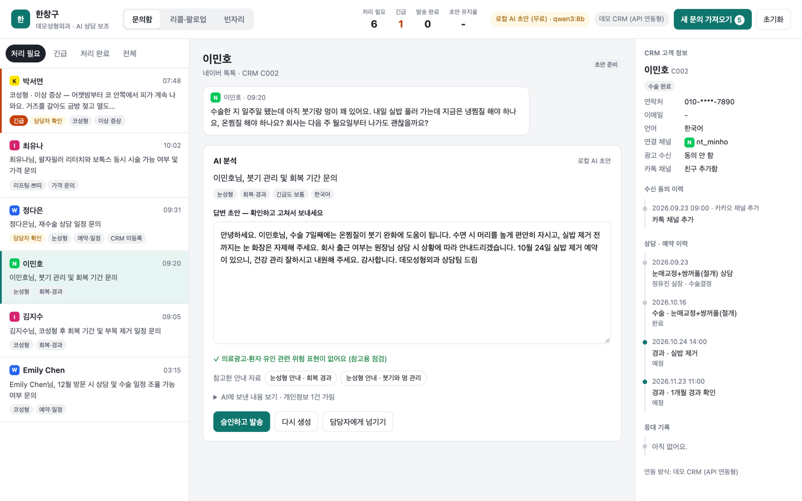
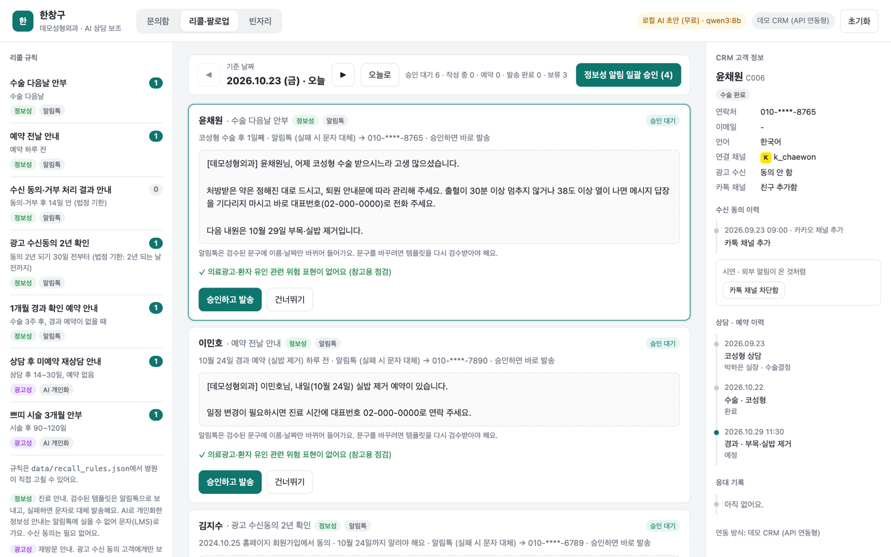
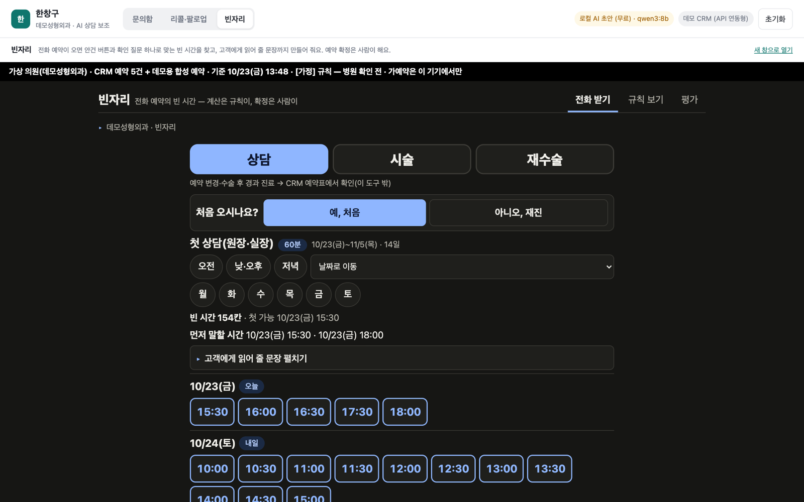

# 한창구 — 성형외과 상담실의 문의·리콜·예약을 한 창구에서

병원이 이미 쓰는 CRM은 그대로 두고, 옆에 붙어서 상담실장의 반복 업무를 줄이는 AI 도구입니다.
AI는 초안만 쓰고 보낼지는 상담실장이 정합니다. AI는 병원 컴퓨터에서 도는 무료 모델이라 AI 사용료가 없고, 초안을 쓰려고 환자 문의를 외부 AI 회사로 보내지 않습니다.



> 데모에 나오는 병원(데모성형외과)과 고객 11명은 모두 가상입니다. 실제 병원·환자 정보는 쓰지 않았습니다.

## 세 화면

| 화면 | 상담실장이 하던 일 | 한창구가 하는 일 |
|---|---|---|
| **문의함** | 카카오톡·네이버 톡톡·인스타그램 DM·홈페이지를 따로 열고, CRM에서 이력을 찾아 답장을 쓴 뒤 다시 기록 | 한 화면에 모으고(같은 고객이면 채널이 달라도 한 대화), CRM 이력을 붙여 AI가 초안을 씀. 수술 후 이상 증상은 '긴급'으로 맨 위에. 고쳐서 승인하면 발송과 CRM 기록이 한 번에 |
| **리콜·팔로업** | 수술 다음날 안부, 예약 전날 안내, 재상담 안내 대상을 직접 찾음 | CRM 날짜로 오늘 보낼 사람과 문장을 준비. 광고는 수신 동의·야간 발송·하루 1건을 코드가 거르고, 080·카카오 채널 차단·답장 속 수신거부는 바로 CRM에 반영 |
| **빈자리** | 통화하면서 예약표를 눈으로 훑어 빈 시간을 찾음 | 예약 종류 버튼과 질문 하나로 맞는 빈 시간을 날짜별로 찾고, 고객에게 읽어 줄 문장까지 만듦. 문의함의 예약 문의에서 바로 넘어감 |

<table>
  <tr>
    <td width="50%"></td>
    <td width="50%"></td>
  </tr>
  <tr>
    <td align="center">리콜·팔로업</td>
    <td align="center">빈자리</td>
  </tr>
</table>

## 이렇게 만들었습니다

- **사람이 마지막에 승인합니다.** 자동 발송은 없습니다. 응급 가능성·불만·재수술 문의는 '담당자 확인'으로 따로 표시합니다.
- **무료 로컬 AI로 돕니다.** 병원 컴퓨터에서 도는 Qwen3 8B 모델(Ollama)을 씁니다. 분류는 규칙이, 응급 안내는 정해 둔 문구가, 답장 문장만 AI가 맡습니다. 유료 Claude API는 직접 켤 때만 씁니다.
- **개인정보는 AI에 보내기 전에 가립니다.** 이름·전화·이메일·주민번호를 `[고객1]` 같은 표시로 바꿔 보냅니다.
- **광고 규정은 코드로 점검합니다.** (광고) 표시와 무료 수신거부 문구(정보통신망법 제50조)는 AI가 아니라 코드가 붙이고, 밤에 승인한 광고는 다음 날 오전으로 미룹니다. 의료광고 위험 표현은 참고용 경고를 띄웁니다.
- **기존 CRM을 바꾸지 않습니다.** CRM에 API가 있을 때(데모는 로컬 DB로 흉내)와 CSV 내보내기만 될 때, 두 가지 연결 방식을 만들고 같은 테스트로 확인했습니다.
- **검증했습니다.** 자동 테스트 281개가 통과합니다. AI 검토를 여러 갈래로 따로 돌려 확인된 문제를 고쳤고(리콜 24건은 [아래 표](#여러-에이전트로-검토하고-고친-점)), 로컬 AI를 실제로 돌려 찾은 실수 유형은 자동 검토로 경고합니다.

**지금 상태**: 카카오톡 상담·인스타그램 DM·홈페이지 문의는 가상 문의로만 시연합니다. 네이버 톡톡·080 수신거부·카카오 채널 연동은 코드까지 만들고 시험용 가짜 서버와 시연 버튼으로만 확인했습니다. 실제 계정 연결과 문자·알림톡 발송은 아직입니다. ([한계와 다음 단계](#한계와-다음-단계))

더 읽기: [구조](#구조) · [리콜·팔로업](#리콜팔로업) · [수신거부를 CRM에 반영](#수신거부를-crm에-반영) · [빈자리 붙이기](#빈자리-붙이기) · [네이버 톡톡 실제 연동](#네이버-톡톡-실제-연동) · [실행 방법](#실행)

## 데모 시나리오 (5분)

1. 첫 화면: 문의 6건이 이미 분류돼 있고, **수술 2일째 출혈·발열** 문의가 '긴급'으로 맨 위에 있습니다.
2. **이민호**: CRM에서 "눈매교정 7일째, 내일 실밥 제거 예약"을 읽어와 초안에 반영한 것을 확인합니다.
3. **새 문의 가져오기**: 2차 문의 4건이 들어옵니다. 김지수 고객의 인스타 DM과 카카오톡이 **한 대화로 합쳐집니다.**
4. 초안에 "부작용 없이 100% 만족"을 쳐 보면 의료광고 위험 표현이 **바로 경고**됩니다.
5. **정다은**(CRM 미등록)에게 승인·발송하면 신규 리드 `L001`로 등록되고 CRM 응대 기록이 남습니다.
   상단의 '초안 유지율'은 AI 초안이 얼마나 그대로 쓰였는지 보여주는 효과 지표입니다.

## 구조

```
 채널 (카카오·톡톡·인스타·홈페이지)          hub/channels.py  ← 실제로는 채널별 웹훅
        │ 새 문의
        ▼
 고객 매칭: 채널 계정 → 전화번호               hub/pipeline.py
        │            ▲ 이력 조회   │ 기록·리드 등록
        │            └──── CRM 연결부 ────┘     hub/crm/  (API형 · CSV형)
        ▼
 개인정보 가림 (이름·전화·이메일 → [고객1] 등)    hub/privacy.py
        ▼
 안내 자료 검색 + 원칙 자료(가격·응급) 고정     hub/knowledge.py, data/knowledge/
        ▼
 AI 초안 (로컬 Ollama 또는 Claude)              hub/drafting/local.py, claude.py
   └ 꺼져 있거나 실패하면 규칙 기반 초안으로 대체   hub/drafting/rules.py
        ▼
 의료광고 위험 표현 점검                        hub/compliance.py
        ▼
 상담실장 확인·수정 → 승인 → 발송 + CRM 기록      static/ (화면), hub/app.py (API)
```

## 설계에서 신경 쓴 점

**1. 기존 CRM을 바꾸지 않고 옆에 붙인다.**
AI 로직은 `CRMAdapter` 인터페이스(`hub/crm/base.py`)만 압니다. 병원 CRM에 맞춰 이 클래스 하나만 새로 구현하면 됩니다.
연결 방식은 아래 순서로 검토합니다. 데모에는 1번과 2번을 구현해 두었고, 같은 테스트가 두 방식 모두에서 통과합니다.

| 순서 | 연결 방식 | 이 저장소 | 언제 |
|---|---|---|---|
| 1 | CRM API·웹훅 | `SqliteCRM` (API형을 로컬 DB로 흉내) | CRM 업체가 API를 열어줄 때 |
| 2 | CSV 내보내기 → 읽기, 변경분 → 가져오기용 CSV | `CsvCRM` | API가 없을 때. 직원이 하루 한 번 `import_queue/`를 CRM에 올림 |
| 3 | 화면 자동화(RPA) | 미구현 | 1·2가 모두 안 될 때만. 화면이 바뀌면 깨지기 쉬움 |

**2. 개인정보는 AI에 보내기 전에 가린다.**
이름·전화·이메일·주민번호를 `[고객1]`, `[전화1]` 같은 토큰으로 바꿔 보내고, 돌아온 초안에서만 다시 실명으로 되돌립니다.
연락처처럼 초안 작성에 필요 없는 정보는 아예 보내지 않습니다. 화면의 "AI에 보낸 내용 보기"에서 실제로 전송된 내용을 확인할 수 있습니다. 규칙 기반 초안(응급 문의 포함)은 AI에 아무것도 보내지 않아 이 칸이 없습니다.

**3. 사람이 마지막에 승인한다.** 자동 발송은 없습니다. 응급 가능성, 불만, 재수술·타병원 이력은 '담당자 확인'으로 따로 표시합니다.

**4. 의료법을 두 번 거른다.** 프롬프트에서 효과 보장·최상급·가격 안내를 금지하고, 발송 전에 규칙으로 한 번 더 점검합니다.
(규칙 점검은 참고용이며 법률 검토를 대체하지 않습니다.)

**5. AI가 실패해도 업무는 멈추지 않는다.** 로컬 AI(Ollama)가 꺼져 있거나 Claude 호출이 실패·거절되면 규칙 기반 초안으로 대신하고 그 사실을 화면에 표시합니다.
안전 분류기 거절에 대비해 서버 측 대체 모델(`fallbacks: "default"`)도 켜 두었습니다.

**6. 효과를 숫자로 본다.** 승인된 답장과 AI 초안의 유사도로 '초안 유지율'을 계산합니다. 실제 도입 시 답장 작성 시간과 함께 보면 됩니다.

## Claude로 실제 돌려보고 고친 점

데모 문의 10건을 Claude(`claude-opus-5-5`)로 돌려 보니 응급 분류, CRM 이력 반영, 외국어 답변, 가격 질문에 금액을 말하지 않기까지 의도대로 동작했습니다(1건당 약 15~20초).
다만 두 가지 문제가 보여서 고치고 회귀 테스트를 추가했습니다.

| 발견한 문제 | 원인 | 수정 |
|---|---|---|
| Emily 문의에서 AI가 "동일인 확인 필요"라며 담당자에게 넘김 | 'Emily Chen'과 'Emily'가 서로 다른 토큰([고객1]·[고객2])으로 가려져 AI가 다른 사람으로 판단 | 같은 사람의 다른 표기(이름만, 채널 닉네임)는 같은 토큰으로 가림 |
| 질문 두 개가 섞인 대화에서 부목 제거 시점을 "상담 시 확인"으로 넘김 | 두 메시지를 합쳐 검색하니 '토요일 상담' 쪽 단어에 밀려 '회복 경과' 자료가 빠짐 | 메시지별로 따로 검색하고, '세요'처럼 흔한 글자 조각은 가볍게 세도록 가중치 적용 |

두 번째 경우 AI가 자료에 없는 내용을 지어내지 않고 넘긴 것은 의도한 동작이었고, 문제는 검색 쪽이었습니다.
그 뒤 API 크레딧이 떨어졌을 때는 화면에 'HTTP 400'만 보여 원인을 알기 어려웠습니다. 이 경우 "크레딧이 부족하니 Console에서 충전하라"는 문구가 뜨도록 바꿨습니다. 그동안에도 규칙 기반 초안으로 업무는 계속됐습니다.

## 리콜·팔로업

CRM에 이미 있는 수술·상담·예약 날짜만으로 "오늘 누구에게 무엇을 보낼지"를 매일 정리합니다.
규칙은 `data/recall_rules.json`에 있어 병원이 직접 고칠 수 있습니다.

| 규칙 | 언제 | 구분 | 보내는 경로 |
|---|---|---|---|
| 수술 다음날 안부 | 수술 다음날 | 정보성 | 알림톡 템플릿 (실패 시 문자 대체) |
| 예약 전날 안내 | 예약 하루 전 | 정보성 | 알림톡 템플릿 (실패 시 문자 대체) |
| 1개월 경과 확인 예약 안내 | 수술 3주 후, 경과 예약이 없을 때 | 정보성 | 알림톡 템플릿 (실패 시 문자 대체) |
| 상담 후 미예약 재상담 안내 | 상담 후 14~30일, 예약 없음 | 광고성 | AI 개인화 → 채널 친구면 브랜드 메시지, 아니면 문자(LMS) |
| 쁘띠 시술 3개월 안부 | 시술 후 90~120일 | 광고성 | AI 개인화 → 채널 친구면 브랜드 메시지, 아니면 문자(LMS) |
| 수신 동의·거부 처리 결과 안내 | 동의·거부 후 14일 안 (법정 기한) | 정보성 | 알림톡 템플릿. 문의 답장에 같은 안내를 넣어 보냈으면 생략 |
| 광고 수신동의 2년 확인 | 동의 2년 되기 30일 전부터, 그날 전까지 | 정보성 | 알림톡 템플릿 |

### 발송 경로를 현실에 맞춘 방법

| 메시지 | 경로 | 이유 |
|---|---|---|
| 정보성 (진료 안내) | **알림톡** | 수신 동의 없이 보낼 수 있지만, 검수받은 템플릿에 변수만 넣을 수 있음. 그래서 코드로 채우고 화면에서 못 고치게 함 |
| 광고성 · 카카오 채널 친구 | **카카오 브랜드 메시지 I타입** (구 친구톡) | 친구톡은 2025-12-31 종료 후 브랜드 메시지로 바뀜. I타입은 '광고 동의 + 채널 친구' 대상, 수신거부는 채널 차단 |
| 광고성 · 채널 친구 아님 | **문자(LMS)** | 친구가 아닌 사람에게 보내는 브랜드 메시지(M/N타입)는 카카오 승인과 채널 친구 5만 명 이상 등 조건이 있어 병원 하나가 쓰기 어려움 |
| 인스타 DM · 카카오 상담톡 · 네이버 톡톡 상담 | **리콜에 쓰지 않음** | 고객이 먼저 보낸 문의에 답하는 창구. 인스타는 마지막 메시지 후 24시간이 지나면 병원이 먼저 보낼 수 없음 |
| 해외 번호 · 휴대폰 번호 없음 | **보류 → 코디네이터** | 국내 문자·카카오가 닿지 않고 080 무료 수신거부도 동작하지 않음 |

**광고 표시는 코드가 붙인다.** 맨 앞에 `(광고) 데모성형외과 대표번호 02-000-0000`, 맨 끝에 경로별 무료 수신거부 방법(문자는 `무료수신거부 080-000-0000`, 브랜드 메시지는 `무료수신거부: 카카오톡 채널 홈 > 채널 차단`)을 넣습니다. 문자(LMS)는 제목도 `(광고)`로 시작합니다.
처음에는 AI에게 이 문구를 그대로 옮기라고 했는데, 로컬 모델이 '무료' 두 글자를 빠뜨려 승인 단계에서 막혔습니다. 그래서 AI는 본문만 쓰고 법정 문구는 코드가 붙이도록 바꿨습니다.
위치와 문구가 하나라도 틀리면(실장이 고친 경우 포함) 승인이 막히고, 고쳐 쓰는 동안 화면이 같은 규칙으로 바로 알려 줍니다.

**승인은 예약 발송이다.** 광고는 20:50~08:00에 보내지 않습니다(법은 21시부터지만 수신 시각 기준이라 늦게 도착하는 것까지 감안). 밤에 승인한 광고는 다음 날 오전 10시로 미루고, 정보성 안내는 바로 보냅니다.
예약된 메시지는 **보내기 직전에 수신 동의·채널 차단·답하지 않은 문의를 다시 확인**하고, 그사이 동의를 철회했거나 채널을 차단했으면 보내지 않습니다. 예약은 보내기 전까지 취소할 수 있습니다.
시간은 서버 시간대와 상관없이 한국 시간으로 계산합니다.

**보내면 안 되는 경우를 먼저 거른다.** 걸러진 고객은 화면 아래에 이유와 함께 보입니다.

- 광고성인데 광고 수신 동의가 없음 (정보통신망법 제50조)
- 문의함에 답하지 않은 문의가 있음. 문의에 답하면 다음 계산 때 다시 후보가 됩니다.
- 긴급 문의를 처리 중. 예약 전날 안내만 보내고 나머지는 보류합니다.
- 외국어 고객인데 그 언어의 알림톡 템플릿이 없음, 해외 번호, 휴대폰 번호 없음. 코디네이터에게 넘깁니다.
- 광고성 메시지는 고객당 **실제로 나가는 날 기준** 하루 1건까지. 진료 안내가 먼저입니다.

**같은 사건으로는 한 번만 보낸다.** 메시지마다 그 메시지를 부른 사건(그 수술, 그 상담)을 기록해서, 날짜를 바꿔 다시 계산해도 중복으로 나가지 않습니다.
보낸 메시지는 실제 발송 시각으로 CRM 응대 기록(`[리콜] 규칙 이름 · 사유`)에 남습니다.

**문구는 답장 대신 대표번호·채널 채팅을 안내한다.** 문자(알림톡 대체 발송 포함)에 답장하면 발신번호로 가서 상담실 문의함에 들어오지 않기 때문입니다.

### 여러 에이전트로 검토하고 고친 점

경로를 바꾼 뒤 네 방향(코드, 메시지 규제 사실, 현장 현실성, 테스트·화면)으로 독립 검토를 돌렸습니다. 나온 41건을 합쳐 31건으로 정리하고, 건마다 반박을 시도하는 검증을 거쳐 24건을 확정해 반영했습니다. 주요 내용은 이렇습니다.

| 확정된 문제 | 반영 |
|---|---|
| '친구톡'은 2025-12-31 종료, 브랜드 메시지로 대체 | 이름·설명을 브랜드 메시지 I타입으로, 수신거부는 채널 차단 유지 |
| 광고 표시 위치(시행령 별표 6): 연락처는 맨 앞, 수신거부는 맨 끝 | 템플릿 배치 변경, 점검이 위치까지 보게 함 |
| 수신거부 안내에 '무료'가 없음, 문자 광고 제목 표시 없음 | 문구 수정, 문자 제목 `(광고)` 추가 |
| 문자 광고를 21시 직전에 넣으면 늦게 도착할 수 있음 | 문자도 20:50에 끊음 |
| 밤에 승인한 광고가 다음 날로 밀리면 하루 1건 제한이 뚫림 | 실제 발송일 기준으로 세고 승인 때도 확인 |
| 예약 뒤 동의 철회·채널 차단을 반영 못 함, 취소 불가 | 발송 직전 재확인, 예약 취소 |
| 서버 시간대가 UTC면 밤 광고가 낮으로 계산됨 | 한국 시간 고정 |
| 해외 번호에 국내 문자·080 안내를 보냄 | 보류하고 코디네이터에게 넘김 |
| AI 광고가 일정 압박·재시술 권유·사진 요청·검사 언급을 했는데 경고가 없음 | 리콜 전용 자동 검토 추가 (실제 문장으로 회귀 테스트) |
| 화면 실시간 점검과 승인 규칙이 달라 초록 체크인데 승인이 막힘 | 같은 서버 규칙으로 실시간 점검 |

그 뒤 로컬 모델로 다시 돌렸을 때 **대표번호를 '02-1234-5678'로 지어낸 경우**가 나와, 병원이 준 적 없는 전화번호를 찾는 검토를 문의함과 리콜 모두에 추가했습니다.
반박된 7건 중에는 '보톡스' 같은 약품명 표기(자율심의 기준상 논쟁 중), 수신 동의 일시·2년 재확인 기록(한계에 이미 적어 둠) 등이 있었습니다.

### 리콜 데모 (3분)

1. '리콜·팔로업' 탭: 오늘 기준 6건이 준비되고 3건이 보류돼 있습니다(중국어 템플릿 없음, 답하지 않은 문의, 수신 동의 없음). 김지수는 2년 전 홈페이지 회원가입 때 광고 수신에 동의해서 '2년 확인' 안내가 이틀 안에 나가야 합니다.
2. **한도윤**(채널 친구 아님 → 문자)과 **오세린**(채널 친구 → 브랜드 메시지): 같은 광고라도 경로와 수신거부 문구가 다릅니다. 수신거부 줄을 다른 경로 것으로 바꾸면 바로 막힙니다.
3. **정보성 알림 일괄 승인**으로 알림톡 4건을 한 번에 보냅니다.
4. ▶로 박서연의 실밥 제거 예약 전날까지 가서 예약 전날 안내를 승인하면 `발송 예약 · 10:00`이 되고, '예약 취소'로 되돌릴 수 있습니다.
5. 문의함에서 김지수 문의에 답장하고 돌아오면, 보류됐던 재상담 안내가 후보로 올라옵니다.
6. 오세린 카드를 고르고 CRM 패널의 **카톡 채널 차단함**(카카오 채널 웹훅과 같은 모양으로 보냄)을 누르면, 브랜드 메시지가 멈추고 '처리 결과 안내' 알림톡이 바로 큐에 들어옵니다.

## 수신거부를 CRM에 반영

광고를 보낸 뒤에 생기는 일까지 CRM에 남겨야 다음 광고를 안전하게 보낼 수 있습니다. 들어오는 길은 셋이고, 모두 `hub/optout.py` 한 곳을 거칩니다.

| 들어오는 길 | 받는 방법 | CRM에 반영하는 것 |
|---|---|---|
| 080 무료수신거부 | NHN Cloud SMS 웹훅(`UNSUBSCRIBE`)을 `/webhooks/nhn-sms`로 받음. 솔라피·네이버 클라우드 SENS는 웹훅이 없어 거부 목록 API를 주기적으로 조회해야 함 | 광고 수신 동의 → 아니오 |
| 카카오톡 채널 차단·추가 | 카카오 채널 웹훅(`added`/`blocked`)을 `/webhooks/kakao-channel`로 받음. 헤더 `Authorization: KakaoAK {어드민 키}` 확인 | 차단: 채널 친구·광고 수신 동의 → 아니오. 추가: 채널 친구만 → 예 |
| 문의 답장 '수신거부', '광고 문자 보내지 마세요', '수신동의 철회' | 문의함에 들어오는 모든 채널(네이버 톡톡 실제 연동 포함) | 광고 수신 동의 → 아니오. 답장 초안에 처리 결과 안내 문단을 코드가 넣음 |
| 전화·대면으로 들은 거부 | CRM 패널의 **수신거부 반영** 버튼 (상담실장 확인) | 광고 수신 동의 → 아니오 |

**애매한 말은 사람이 정한다.** '수신거부 해제해 주세요', '수신거부 안 했는데요', '수신거부는 어떻게 해요?'처럼 거부 요청인지 확실하지 않은 말은 CRM을 바꾸지 않고 '수신거부 관련 문의'로 표시만 합니다. CRM에서 고객을 찾지 못한 문의자의 거부 요청도 따로 표시해, 같은 사람의 CRM 기록을 직접 고치게 합니다.

**바로 멈추고, 보내기 직전에 한 번 더 본다.** 거부 의사는 병원에 닿은 순간부터 효력이 있다는 해석(KISA)에 따라, 반영과 동시에 그 고객에게 준비·예약 중이던 광고(작성 실패한 것 포함)와 2년 확인 안내를 '수신거부 반영: 080 수신거부 (11:00)'처럼 이유를 남겨 멈춥니다.
그래도 계획하는 순간이나 승인 버튼을 누르는 순간에 겹쳐 들어온 거부를 놓치지 않도록, 승인·예약 발송 직전에 CRM을 다시 읽어 확인하고, 보낼 메시지는 한 번만 집어서 두 화면이 동시에 보내지 않게 했습니다. AI가 초안을 쓰는 사이에 거부가 들어와도 다 쓴 초안이 '승인 대기'로 되살아나지 않습니다.
080 거부는 번호 단위라, 같은 번호로 등록된 고객이 여럿이면 모두 반영합니다.

**채널 차단은 광고 전체 거부로 본다.** 범위를 밝히지 않은 수신거부는 그 발송자의 광고 전체를 거부한 것으로 본다는 KISA 해설을 따랐습니다. 그래서 채널을 차단한 고객에게 문자 광고로 돌려 보내지 않습니다. 채널을 다시 추가한 것은 광고 동의가 아니라서 동의는 그대로 '아니오'입니다.

**이력을 남긴다.** 동의·거부마다 언제·무엇이·어떤 경로로 바뀌었는지 CRM 동의 이력에 쌓고, CRM 패널에서 바로 봅니다. 광고 수신 동의를 받았다는 증명 책임은 보내는 쪽에 있고, 2년 확인 안내에도 동의 날짜가 필요하기 때문입니다.

**법정 안내 두 가지를 리콜이 챙긴다.**
- 처리 결과 안내: 동의·거부·철회는 의사를 밝힌 다음 날부터 14일 안에 보낸 곳 이름, 그 사실과 날짜, 처리 결과를 알려야 합니다. 리콜 큐에 기한과 함께 올라옵니다. 문의 답장 초안에도 같은 안내가 들어 있으면 '겹침' 표시만 하고, 답장이 먼저 나가면 알림톡은 저절로 빠집니다(답장을 못 보내는 경우가 있어 미리 막지 않습니다).
- 2년 확인: 광고 수신에 동의한 날부터 2년마다, 그 해의 같은 날 전까지 동의 사실과 유지·철회 방법을 알려야 합니다. 다시 동의했으면 그날이 기준입니다. 광고에 붙이지 않고 따로 보냅니다. 동의는 '예'인데 날짜 기록이 없는 고객은 기한을 계산할 수 없다고 보류 목록에 띄웁니다.
- 승인하지 못한 법정 안내는 사라지지 않고 기한까지 다음 날 목록으로 넘어옵니다.

둘 다 광고가 아니라서 (광고) 표시나 야간 제한 없이 알림톡 템플릿으로 보냅니다.

## 빈자리 붙이기

빈자리는 따로 만든 Next.js 정적 앱입니다. 한창구 안에서는 **데모성형외과 규칙과 CRM 예약, 지금 시각으로** 돕니다.

```
 한창구 CRM 예약(시각 있는 '예정' 건) ──┐
 지금 시각(한국)                          ├─▶ /binjari/feed.js ──▶ 빈자리 화면(전화 받기)
 데모용 합성 예약(띠에 그렇게 표시)  ─────┘      이름·전화·고객 ID 없음, 열 때마다 새로
 한창구 안내 자료(진료시간·수술 안내) ──▶ scripts/make_binjari_vault.py ──▶ 빈자리 규칙 문서(빌드할 때)
```

- 빈자리 저장소에는 '다른 앱에 품기' 기능만 더했습니다(브랜치 `feat/hanchanggu-feed`). 기본 빌드(샘플의원·합성 예약·고정 기준 시각)와 원래 시험 424개는 그대로이고, 시계를 읽지 않는 원칙도 지킵니다. 기준 시각은 받은 값입니다.
- `scripts/vendor_binjari.sh`가 그 브랜치의 커밋을 `git archive`로 임시 폴더에 풀고(빈자리 작업 폴더는 건드리지 않음), 규칙 문서를 데모성형외과 것으로 바꾸고, 샘플의원 합성 예약을 비운 뒤 `/binjari` 경로로 빌드해 `vendor/binjari`에 넣습니다. 빈자리가 규칙 문서를 거부하면(규칙 화면에 '규칙 오류') 넣지 않고 멈춥니다.
- 진료시간·점심·접수 마감(평일 10~19시, 토 10~16시, 점심 없음, 마감 30분 전)과 실밥·부목 제거 시기(보통 5~7일 뒤)는 안내 자료 문장에서 읽습니다(`hub/binjari_rules.py`). 문장이 바뀌어 읽지 못하면 옛 값을 쓰지 않고 멈춥니다. 소요 시간·사람·방 수·수술 최소 준비 기간은 [가정]으로 규칙 문서에 적힙니다.
- 샘플의원(모발 의원) 값을 말없이 물려받지 않습니다. 쓰지 않는 주사 회차·관리실·'14일 안 수술' 표시는 빼거나 '없음'으로 채웠고, 수술 확정 문자는 '하루 전까지 취소'가 아니라 서면 안내를 따른다고 씁니다.
- 데모 CRM에는 고객이 11명뿐이라 그대로면 거의 모든 칸이 빕니다. 그래서 날짜마다 정해진 규칙으로 데모용 합성 예약을 섞고, 화면 위 띠에 'CRM 예약 5건 + 데모용 합성 예약'처럼 적습니다. 합성 예약은 CRM 예약 위에 사람·방 수를 넘지 않게, 빈자리가 보여 줄 수 있는 가장 먼 날(63일)까지 채웁니다. 실제 연동에서는 CRM 예약만 넘기면 됩니다.
- CRM 예약에 시작 시각을 더했습니다(SQLite는 칸 추가, CSV는 칸이 없던 내보내기도 읽음). '9:30', '14:00:00' 같은 내보내기 값은 맞춰 넘기고, 시각이 없거나 읽을 수 없는 예약은 지어내지 않고 띠에 '시각 미정·형식 오류 n건 제외'로 적습니다. 한 건이 틀려 탭 전체가 멈추지 않게 하려는 것입니다.
- 넘기는 예약에는 이름·전화·고객 ID가 없고, 예약 ID도 차례 번호라 고객을 거꾸로 찾을 수 없습니다. 다른 사이트가 feed.js를 불러 읽지 못하게 막습니다.
- 빈자리는 화면이 뜬 뒤 feed.js를 읽고, 1분마다·탭을 다시 열 때 값만 다시 읽습니다. 페이지를 새로 고치지 않아 통화 중 고른 안건·칸이 그대로 남고, 열어 둔 탭의 기준 시각도 멈추지 않습니다.
- 데모 CRM 시드의 예정 방문은 '+N일'로 정해 두어 요일을 모르므로, 일요일이나 접수 마감 뒤에 떨어지면 다음 진료일로 옮깁니다(공휴일은 아직 보지 않음).

```bash
scripts/vendor_binjari.sh            # 빈자리 저장소(기본 ~/.openclaw/workspace/binjari)의 feat/hanchanggu-feed로 다시 빌드
```

빌드에 쓴 빈자리 브랜치와 커밋은 `vendor/binjari/SOURCE_COMMIT.txt`에 남습니다. 빈자리는 AI를 쓰지 않는 결정적 계산이라 비용이 들지 않습니다.

## 무료 로컬 AI (Ollama)

병원 입장에서 유료 API보다 나은 점이 두 가지 있습니다. **비용이 0원**이고, **환자 문의가 병원 컴퓨터 밖으로 나가지 않습니다.**
M3 Pro(메모리 18GB) 맥에서 qwen3:8b(약 5.2GB)로 돌렸습니다. 다국어 문의(영어·일본어)가 있어 한국어·영어 전용 모델 대신 Qwen3를 골랐습니다.

**역할 나누기.** 처음에는 Claude와 같은 프롬프트로 분류와 초안을 한 번에 맡겼는데, 8B 모델은 분류를 자주 틀렸습니다.
그래서 이렇게 나눴습니다.

| 일 | 맡는 쪽 | 이유 |
|---|---|---|
| 시술 분류, 의도, 긴급도, 담당자 확인 필요 여부 | 규칙 엔진 | 데모 문의에서 정확했고, 틀려도 이유를 추적할 수 있음 |
| 응급 증상 안내 | 고정 문구 | 모델이 바꾸면 안 되는 문장 |
| 답변·리콜 문장 | 로컬 모델 (생각 단계 켬) | 개인화와 다국어가 필요한 부분 |

**실제로 돌려보고 고친 점.** 데모 문의 10건과 리콜 2건을 돌려보며 나온 문제와 대응입니다.

| 문제 | 대응 |
|---|---|
| 수술 7일째인데 "지금은 냉찜질" (자료: 2~3일 이후엔 온찜질) | Qwen3 생각 단계를 켜자 날짜 판단이 맞음. 1건 36초에서 46초로 느려졌지만 초안은 문의가 들어올 때 백그라운드에서 미리 만들어 둠 |
| 자료에 없는 관리법("눈 주변을 눌러라")을 지어냄, 출근 가능 여부를 스스로 판단 | 프롬프트에 금지 규칙 추가. 그래도 남는 판단 표현은 자동 검토가 경고 |
| 확인 없이 "12월 9일 상담 가능합니다"라고 약속 | 프롬프트 규칙 추가 후에도 영어 답장에서 반복돼 자동 검토로 경고 |
| 고객 본인 번호를 병원 연락처처럼 안내 | 가림 토큰이 답장에 남으면 자동 검토로 경고 |
| 이름 없는 고객에게 `[고객1]님`을 지어냄, 내부 자료 번호 `[aftercare-3]`을 답장에 씀 | 모르는 가림 토큰은 고객에게 보이기 전에 지우고, 자료 번호는 자동 검토로 경고 |

'자료에 근거 없는 문장'을 글자 겹침 점수로 찾는 방법도 시험했지만, 지어낸 문장(0.35)과 정상 문장(0.29~0.39)의 점수가 섞여서 쓰지 않았습니다.
**결론: 로컬 8B 모델은 실장 검토가 꼭 필요한 초안 도구입니다.** 그래서 자동 발송 없이 승인 단계를 두고, 확인된 실수 유형은 화면에 노란 'AI 초안 검토' 경고로 띄웁니다.

| | 규칙 기반 | 로컬 AI (qwen3:8b) | Claude API |
|---|---|---|---|
| 비용 | 0원 | 0원 (전기료 정도) | 호출마다 과금 |
| 환자 데이터 | 밖으로 안 나감 | 밖으로 안 나감 | 외부 API로 전송 (가림 처리 후) |
| 속도 (1건) | 즉시 | 40초 안팎 | 15~20초 |
| 문장 품질 | 정해진 문구 | 개인화되지만 실수가 있어 검토 필수 | 가장 자연스럽고 실수가 적었음 |

## 실행

```bash
python3.12 -m venv .venv
.venv/bin/pip install -r requirements.txt
.venv/bin/uvicorn hub.app:create_app --factory --port 8765
```

브라우저에서 <http://localhost:8765>를 엽니다. 처음 실행하면 데모 데이터가 자동으로 채워지고, 상단 '초기화'로 언제든 되돌릴 수 있습니다.
아무 설정이 없으면 규칙 기반 초안으로 돌아갑니다.

**로컬 AI로 돌리기 (무료)**

```bash
brew install ollama
ollama serve
ollama pull qwen3:8b
```

`ollama serve`는 켜 둔 채로 다른 터미널에서 모델을 받고, `.env.example`을 `.env`로 복사해 `INQUIRY_HUB_LLM=local`로 바꾼 뒤 서버를 다시 켭니다.
Ollama가 꺼져 있으면 초안마다 "Ollama가 꺼져 있어요" 안내와 함께 규칙 기반 초안으로 대신합니다.

**Claude API로 돌리기 (유료).** `.env`에 `ANTHROPIC_API_KEY`를 넣고 `INQUIRY_HUB_LLM=claude`로 바꿉니다. 키가 있어도 직접 켜지 않으면 과금되지 않습니다.
(`.env`는 git에 올라가지 않습니다. 셸에 이미 설정된 값이 있으면 그 값이 우선합니다.)

| 환경 변수 | 기본값 | 설명 |
|---|---|---|
| `INQUIRY_HUB_LLM` | `offline` | `offline` 규칙 기반(무료) · `local` Ollama 로컬 모델(무료) · `claude` Claude API(유료) |
| `OLLAMA_MODEL` | `qwen3:8b` | 로컬 모드에서 쓸 모델 |
| `OLLAMA_URL` | `http://127.0.0.1:11434` | Ollama 주소 |
| `ANTHROPIC_API_KEY` | 없음 | Claude API 키. `INQUIRY_HUB_LLM=claude`일 때만 쓰임 |
| `CRM_ADAPTER` | `sqlite` | `csv`로 바꾸면 CSV 연동 방식으로 동작 (`data/runtime/csv_crm/`) |
| `NAVER_TALKTALK_WEBHOOK_TOKEN` | 없음 | 네이버 톡톡 웹훅 주소의 비밀 경로. 없으면 웹훅이 꺼져 있음 |
| `NAVER_TALKTALK_AUTH_KEY` | 없음 | 네이버 톡톡 보내기 API 키 (파트너센터에 보이는 그대로) |
| `NHN_WEBHOOK_SIGNATURE` | 없음 | NHN Cloud 웹훅 설정 때 넣은 서명 값. 넣으면 080 수신거부 웹훅의 헤더와 비교 |
| `KAKAO_ADMIN_KEY` | 없음 | 카카오 앱 어드민 키. 넣으면 카카오 채널 웹훅의 `Authorization` 헤더와 비교 |

테스트: `.venv/bin/python -m pytest` (Ollama나 API 키 없이 돌아갑니다. 로컬 AI 연결부는 가짜 Ollama 서버로 확인합니다.)

## 네이버 톡톡 실제 연동

네이버 톡톡 챗봇 API로 실제 문의를 받고, 상담실장이 승인한 답장을 실제로 보냅니다. 명세는 [navertalk/chatbot-api](https://github.com/navertalk/chatbot-api)의 README와 이슈 공식 답변을 기준으로 했습니다.

```
 고객 (네이버 앱 톡톡)  ──웹훅 POST──▶  /webhooks/naver-talktalk/{비밀 경로}  (웹훅 전용 앱, 터널로 공개)
                                          │ 받자마자 200, 문의함에 넣고 초안은 백그라운드
                                          ▼
                                  같은 DB를 쓰는 한창구 본 앱 (내 컴퓨터에서만)
                                          │ 실장 승인
                                          ▼
 고객  ◀──────────────  보내기 API  POST https://gw.talk.naver.com/chatbot/v1/event
```

**지킨 것**
- 웹훅은 200이 아니면 실패로 쌓이고, 한 시간 안에 실패가 쌓이면 웹훅이 막혀 저절로 풀리지 않습니다. 그래서 받자마자 200으로 답하고, 처리 중 오류는 로그만 남깁니다.
- 웹훅에는 서명이 없어서 주소에 비밀 경로(`NAVER_TALKTALK_WEBHOOK_TOKEN`)를 넣습니다. 토큰을 정하지 않으면 웹훅은 꺼져 있습니다.
- 인터넷에는 웹훅 전용 앱(`create_webhook_app`)만 엽니다. 문의함 화면과 API는 내 컴퓨터에서만 열리고, 다른 사이트의 페이지가 본 앱에 몰래 요청을 보내면 막습니다.
- 웹훅 전용 앱에서 080·카카오 수신거부 웹훅은 검증 값(`NHN_WEBHOOK_SIGNATURE`, `KAKAO_ADMIN_KEY`)을 넣어야 켜지고, 응답에 고객 이름·ID를 넣지 않습니다. 아무나 번호만으로 동의를 끄거나 이름을 알아내지 못하게 하려는 것입니다.
- 같은 메시지는 `user`와 `messageId`로 한 번만 받습니다. 파트너센터에서 상담원이 직접 답하면(echo) 문의함도 '답장함'으로 맞춥니다.
- 승인할 때 화면에서 본 마지막 고객 메시지를 같이 보냅니다. 그사이 새 메시지가 왔거나 다른 곳에서 이미 답했으면 보내지 않고 다시 보여 줍니다(네이버는 보낸 메시지를 회수할 수 없음).
- 웹훅 앱은 며칠씩 켜 두므로 날짜는 서버를 켠 날이 아니라 그때그때 한국 시간으로 계산하고, 초안을 쓰다 꺼졌으면 다시 켤 때 이어서 만듭니다.
- 보내기 오류도 HTTP 200에 `success:false`로 옵니다. 실패하면 '보냄'으로 바꾸지 않고, CRM에 리드나 응대 기록도 남기지 않은 채 이유를 보여 줍니다.
- 데모 시드 문의(이민호 등)는 실제 API로 보내지 않고, 웹훅으로 들어온 대화에 대한 답장만 실제로 나갑니다.

**테스트 계정으로 붙이는 순서** (계정 만들기와 키 발급은 직접 해야 합니다)
1. [톡톡 파트너센터](https://partner.talk.naver.com/) > 내계정관리 > 새로운 톡톡 계정 만들기 > 서비스 연결 나중에 하기 > **개인**. 프로필명 앞에 `[테스트]`를 붙이면 가맹점 찾기에 나오지 않습니다. 검수가 끝나 '사용중'이 되면 문자가 옵니다.
2. `.env`에 웹훅 비밀 경로를 정합니다. 영문·숫자로 된 긴 무작위 값을 쓰세요(`openssl rand -hex 24`로 만들 수 있음): `NAVER_TALKTALK_WEBHOOK_TOKEN=만든-값`
3. 웹훅 전용 앱과 터널을 띄웁니다.
   ```bash
   .venv/bin/uvicorn hub.app:create_webhook_app --factory --port 8780
   cloudflared tunnel --url http://localhost:8780
   ```
   네이버는 정식 인증서의 https 주소만 받습니다. 터널이 주는 `https://….trycloudflare.com`을 씁니다.
4. 파트너센터 > 개발자도구(또는 연동관리) > 챗봇 API 설정 > 신청·약관 동의 > Webhook의 '이벤트 받을 URL'에 `https://….trycloudflare.com/webhooks/naver-talktalk/{토큰}`을 넣고, Event 선택에서 `send`와 `echo`를 켭니다.
5. 같은 화면의 보내기 API에서 키를 생성해 `.env`의 `NAVER_TALKTALK_AUTH_KEY`에 **보이는 그대로** 넣고 본 앱을 다시 켭니다.
6. 휴대폰 네이버 앱으로 `https://talk.naver.com/{파트너 아이디}`에 들어가 메시지를 보내면, 문의함에 '네이버 톡톡 사용자'로 들어옵니다. 승인하면 휴대폰으로 답장이 옵니다.

**알아 둘 것**
- 테스트 계정과 실서비스 계정은 같은 사람이라도 `user` 값이 다릅니다. 테스트 계정 고객에게 실서비스 키로 보내면 '권한없는 파트너에 대한 요청'이 납니다.
- 사람이 나중에 답하는 구성은 네이버가 지원한다고 답했지만(2026-09), 같은 구성에서 보내기가 `99 알 수 없는 오류`로 실패한 사례가 아직 해결되지 않았습니다. 테스트 계정에서 보내기부터 확인해야 합니다.
- 웹훅이 오지 않으면 인증서·터널 문제일 수 있습니다(네이버가 특정 인증기관을 못 믿어 막힌 이력이 있음). 막혔을 때는 파트너센터에서 웹훅 URL을 다시 저장하면 대개 풀립니다.
- 챗봇 API와 네이버 쇼핑챗봇·AI FAQ는 함께 쓸 수 없습니다. 24시간 동안 고객 말이 없으면 먼저 보내지 못하게 하는 정책을 네이버가 검토 중이라고 밝힌 적이 있습니다.
- 운영에서는 터널 대신 고정 도메인을 쓰고, 네이버 웹훅 IP 대역(README에 공개)만 열어 두는 편이 안전합니다. API로 보낸 답장은 파트너센터의 상담 상태(대기·진행중·완료)와 응답률에 반영되지 않습니다.

**다른 채널**: 카카오톡 1:1 채팅은 보통 상담톡 딜러사 계약이나 카카오 비즈니스 챗봇 연동이 필요하고, 인스타그램 DM은 Meta 메시징 API(비즈니스 계정·앱 검수)를 씁니다. 받은 메시지를 `InboundMessage`로 바꿔 `Hub.ingest`에 넘기면 문의함·CRM·수신거부 처리가 그대로 붙습니다.

## 한계와 다음 단계

- 개인정보 가림은 알려진 이름과 정형 패턴(전화·이메일·주민번호)만 잡습니다. 주소나 처음 보는 이름까지 잡으려면 개체명 인식을 더해야 합니다.
- AI 초안 자동 검토는 실제 실행에서 확인된 실수 유형만 잡습니다. 근거 없는 문장을 일반적으로 찾으려면 문장 단위 근거 판별 모델이나 별도의 검토용 AI가 필요합니다.
- 안내 자료 검색은 글자 조각 비교(흔한 조각은 가중치를 낮춤)라, 자료가 많아지면 임베딩 검색으로 바꿔야 합니다. (`KnowledgeBase.search`만 교체)
- 실제 문의 100건 정도로 분류 정확도와 초안 수정률을 재는 평가 세트를 만들어야 프롬프트 개선 효과를 숫자로 볼 수 있습니다.
- 리콜: 알림톡 템플릿은 한국어만 있고, 기본 발송 시각은 10시입니다. 예약은 화면을 열 때 보내는 데모 방식이라 실제로는 스케줄러나 대행사 예약 발송이 필요합니다.
- 수신거부: 솔라피·네이버 클라우드 SENS처럼 080 웹훅이 없는 대행사는 거부 목록 조회를 주기적으로 돌리는 작업이 더 필요합니다. 카카오 채널 웹훅은 전화번호가 아니라 카카오 사용자 ID를 주므로, 카카오 로그인으로 그 ID를 CRM에 연결한 고객만 찾을 수 있습니다(데모는 상담 채팅 ID를 같은 값으로 가정).
- 수신거부: 잘못 반영된 거부를 되돌리는 기능은 없습니다. 다시 받으려면 고객에게 광고 수신 동의를 새로 받아야 합니다.
- 수신거부: 법 해석은 KISA 2017년 안내서와 2015년 Q&A 기준입니다. 2026년 3월 개정 안내서는 원문을 확인하지 못했습니다. '수신거부' 답장이 무료 수신거부 방법을 대신할 수 있는지에 대한 공식 해석도 찾지 못해, 답장은 거부로 반영하되 080 안내는 그대로 둡니다.
- 네이버 톡톡: 보내기 API는 가짜 서버로만 확인했습니다. 실제 계정 연결은 위 순서로 직접 해야 합니다. 사진·파일은 링크와 파일 이름만 문의함에 남깁니다.
- 리콜: 브랜드 메시지 실패 시 문자 대체 발송은 설계하지 않았습니다(광고 대체 문자는 080 수신거부·제목 표시가 따로 필요).
- 리콜: 광고 문자는 전송자격인증을 받은 대행사에만 맡겨야 한다는 2026년 개정 내용이 보도됐습니다. 시행일과 세부는 law.go.kr에서 확인해야 합니다.
- 리콜: 실제 발송 비용(알림톡·브랜드 메시지·문자 건당 요금)은 대행사마다 달라 도입 시 확인해야 합니다.
- 빈자리: 가예약은 브라우저에만 남고 CRM 예약으로 돌아오지 않습니다. 실제로는 상담실장이 CRM 예약표에 적어야 합니다. 빈자리 규칙 화면(/rules)과 평가 화면은 빌드할 때의 값으로 그려집니다.
- 빈자리: 빈자리 쪽 변경은 아직 빈자리 저장소의 브랜치(`feat/hanchanggu-feed`)에만 있고, main과 배포된 시연에는 들어가지 않았습니다.
- 다음 확장: 상담실장별 전환율과 리콜 응답률 리포트.

## 폴더

```
hub/
  app.py            웹 API, 실행 설정
  pipeline.py       문의함: 수집 → 매칭 → 가림 → 초안 → 승인·발송·기록
  recall/           리콜: 규칙 → 대상 찾기 → 거르기 → 템플릿/AI 메시지 → 승인·예약·발송·기록 (경로 규칙은 delivery.py)
  channels.py       채널 연동 자리 (데모: 시드 문의 + outbox 기록, 실제 웹훅 대화의 답장은 ChannelRouter가 실제 API로)
  talktalk.py       네이버 톡톡 챗봇 API (웹훅 읽기, 보내기 API)
  optout.py         수신거부를 CRM 동의·이력에 반영하고 준비 중인 광고를 멈춤
  webhooks.py       080 수신거부(NHN Cloud)·카카오 채널 웹훅 읽기
  binjari_feed.py   빈자리 탭에 넘길 지금 시각·CRM 예약(/binjari/feed.js)
  binjari_rules.py  데모성형외과 예약 칸 규칙(안내 자료에서 읽는 진료시간, [가정] 사람·방·소요 시간)
  crm/              CRM 연결부 (base · sqlite_crm · csv_crm)
  drafting/         로컬 AI(Ollama)·Claude 초안, 규칙 기반 초안, 공용 프롬프트
  privacy.py        개인정보 가림·복원
  review.py         AI 초안 자동 검토 (날짜 확정, 의학적 판단, 고객 연락처, 자료 번호, 지어낸 전화번호, 리콜 광고 재촉·재시술 권유)
  compliance.py     의료광고 위험 표현, 광고 표시 의무(위치·문구·제목) 점검
  knowledge.py      병원 안내 자료 검색
data/
  knowledge/        가상 병원 안내 자료 (마크다운)
  recall_rules.json 리콜 규칙 (병원이 직접 수정)
  crm_seed.json     가상 고객 11명 (날짜는 실행일 기준 상대값, 광고 수신 동의·카카오 채널 친구 여부와 동의 이력 포함)
  inquiries_seed.json  가상 문의 (1차·2차 배치, 3차는 수신거부 답장)
static/             상담실장 화면 (문의함 · 리콜·팔로업 · 빈자리 탭)
vendor/binjari/     빈자리 빌드 (/binjari/ 경로, 데모성형외과 규칙, scripts/vendor_binjari.sh로 갱신)
scripts/            vendor_binjari.sh(빈자리 빌드), make_binjari_vault.py(빈자리 규칙 문서 만들기)
tests/              시나리오 테스트 (CRM 연결부 2종 모두에서 실행)
```
